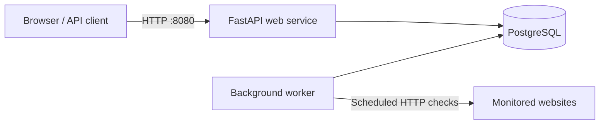

# PulseWatch

PulseWatch is a Python uptime-monitoring service that checks website availability, records HTTP status codes and response times, and displays monitoring history through a web dashboard.

This repository is used as a DevOps portfolio project. The FastAPI application serves as the workload, while my contribution focuses on containerization, multi-service orchestration, database integration, CI/CD, operational reliability, security, and infrastructure automation.

## Features

- User registration and cookie-based authentication
- User-specific website monitors
- Manual and scheduled HTTP checks
- Response-time and uptime history
- Monitor pause and deletion controls
- Basic SSRF protection that blocks private and local network targets
- Liveness endpoint at `GET /api/health` and database-aware readiness endpoint at `GET /api/ready`
- Authenticated monitor API at `GET /api/monitors`

## Architecture



The web and worker containers use the same application image but run different commands:

- `web` serves the dashboard and API through Uvicorn.
- `worker` finds due monitors and performs scheduled checks.
- `db` stores users, monitors, and check results in PostgreSQL.

Docker Compose provides service discovery through the `db` hostname. PostgreSQL data is preserved in a named volume.

## Technology stack

### Application

- Python 3.13
- FastAPI and Uvicorn
- SQLAlchemy
- PostgreSQL and Psycopg
- Pytest

### DevOps

- Docker (non-root image) and Docker Compose
- GitLab CI/CD, GitLab Container Registry, GitLab-managed Terraform state
- Terraform (custom modules, unit-tested with mocked providers)
- AWS: VPC, EKS Auto Mode, RDS PostgreSQL, Application Load Balancer, IAM OIDC federation
- Kubernetes with Kustomize (Deployments, Job, Ingress, HPA, PodDisruptionBudget, Pod Security Standards)
- Trivy, kubeconform, GitLab SAST and secret detection

## Run with Docker Compose

### Prerequisites

- Docker Desktop or Docker Engine
- Docker Compose v2

Create a `.env` file in the project root:

```dotenv
POSTGRES_USER=pulsewatch_user
POSTGRES_PASSWORD=replace-with-a-local-password
POSTGRES_HOST=db
POSTGRES_PORT=5432
POSTGRES_DB=pulsewatch_db

DATABASE_URL=postgresql+psycopg://pulsewatch_user:replace-with-a-local-password@db:5432/pulsewatch_db
SESSION_SECRET=replace-with-a-long-random-value
```

The real `.env` file is excluded from Git and the Docker build context.

Build the application image:

```bash
docker build -t image_test:v1 .
```

Start the complete stack:

```bash
docker compose up -d
```

Open the application at [http://localhost:8080](http://localhost:8080).

Verify the services:

```bash
docker compose ps
curl http://localhost:8080/api/health
docker compose logs worker
```

Stop the stack:

```bash
docker compose down
```

Use the following command only when you intentionally want to delete the local PostgreSQL data:

```bash
docker compose down -v
```

## Run directly with Python

Python 3.13 is recommended.

```bash
python3 -m venv .venv
source .venv/bin/activate
pip install -r requirements-dev.txt
export SESSION_SECRET="replace-with-a-long-random-value"
python manage.py runserver
```

The direct local setup uses SQLite by default.

Start the background worker in another terminal:

```bash
source .venv/bin/activate
python manage.py worker
```

Manual checks continue to work without the worker, but scheduled checks require it.

## Tests

Run the automated tests with:

```bash
python manage.py test
```

## CI/CD pipeline and cloud deployment

Every commit goes through a GitLab pipeline. Commits on `main` are deployed to
AWS: Terraform provisions the platform and the application runs on Kubernetes
(Amazon EKS).

```text
validate ─▶ test ─▶ build ─▶ scan ─▶ infrastructure ─▶ staging ─▶ production
 tf test     pytest   image    trivy    terraform plan     auto       manual
 kubeconform postgres :sha     gate     → manual apply     + smoke    + smoke
```

| Stage | What happens |
|-------|--------------|
| validate | `terraform fmt/validate/test`, Kustomize render + `kubeconform -strict`, Trivy IaC scan |
| test | pytest, a schema + readiness test on real PostgreSQL 16, GitLab SAST and secret detection |
| build | Docker image tagged with the commit SHA, pushed to the GitLab registry |
| scan | Trivy blocks delivery on fixable CRITICAL vulnerabilities |
| infrastructure | When `terraform/` changes: `terraform plan`, a human reviews it, then `terraform apply` |
| staging | Migration Job → rolling update → automatic rollback on failure → smoke test through the ALB |
| production | Manual promotion of the **same image**, then the same smoke test |

Highlights:

- **No cloud keys in GitLab.** Jobs exchange a GitLab OIDC token for temporary
  AWS credentials, and only pipelines on `main` are trusted.
- **Terraform owns the platform** (VPC, EKS Auto Mode, one RDS database per
  environment, namespaces and secrets); **Kustomize owns the app** (`k8s/`).
- **Hardened workloads**: non-root, read-only filesystem, `restricted` Pod
  Security Standard, readiness vs liveness probes, HPA, PDB, zero-downtime
  rolling updates.
- A **manual `terraform:destroy` job** removes everything to stop AWS costs.

The full walkthrough covers the architecture diagram, how each stage works,
setup steps, costs and design trade-offs: **[docs/deployment.md](docs/deployment.md)**.

### Repository layout

```text
app/                 FastAPI application (web + worker)
tests/               pytest suite
Dockerfile           non-root runtime image
docker-compose.yml   local stack
.gitlab-ci.yml       CI/CD pipeline
ci/                  deploy.sh (rollout + rollback), smoke-test.sh
k8s/
  base/              Deployments, Service, Ingress, HPA, PDB, migration Job
  overlays/          staging / production differences
  platform/          cluster-wide IngressClass (EKS Auto Mode ALB)
terraform/
  bootstrap/         one-time GitLab → AWS OIDC trust + CI role
  modules/           network, eks, database
  tests/             terraform test (mocked providers)
  *.tf               root stack: wires modules, namespaces, secrets
docs/deployment.md   how the pipeline works
```

## Operational commands

```bash
# Display service status
docker compose ps

# Follow all service logs
docker compose logs -f

# Follow individual service logs
docker compose logs -f web
docker compose logs -f worker
docker compose logs -f db

# Recreate containers after configuration changes
docker compose up -d --force-recreate
```

## Security considerations

- Secrets are supplied through environment variables and are not committed. In AWS they are generated by Terraform and written straight into Kubernetes Secrets.
- The container runs as an unprivileged user (UID 10001) with a read-only root filesystem in Kubernetes.
- CI/CD authenticates to AWS with short-lived OIDC credentials; no access keys are stored.
- Session cookies are cryptographically signed using `SESSION_SECRET`.
- Monitor targets are checked against private and local IP ranges to reduce SSRF risk.
- PostgreSQL is available only through the internal Compose network by default.
- The database volume is kept separate from the application containers.

## Roadmap

Done:

- [x] Run the application image as a non-root user
- [x] Add application readiness and health checks
- [x] Add dependency and container-image security scanning
- [x] Deploy the application to a real environment (AWS EKS, staging + production)
- [x] Add Kubernetes manifests (Kustomize)
- [x] Provision infrastructure using infrastructure as code (Terraform)

Next:

- [ ] Make Docker Compose build the application image from a clean clone
- [ ] Add Alembic database migrations (run inside the existing migration Job)
- [ ] HTTPS with ACM and a custom domain
- [ ] Add Prometheus metrics, Grafana dashboards, and alerting
- [ ] GitOps delivery with Argo CD

## Project scope

PulseWatch intentionally uses a small application so that the repository can demonstrate a complete DevOps lifecycle: packaging, testing, image delivery, orchestration, observability, deployment, and operational documentation.
