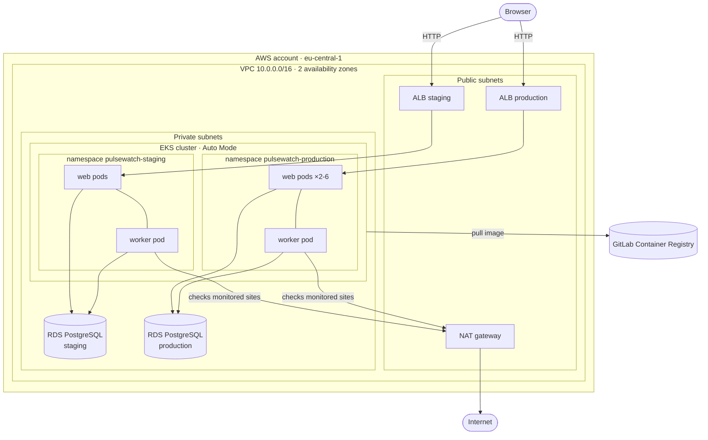
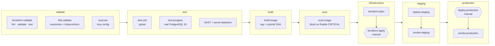
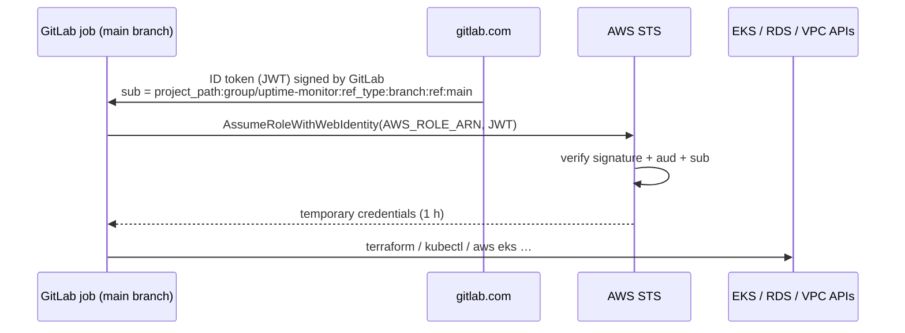

# Deployment pipeline: GitLab CI → Terraform → Kubernetes (AWS EKS)

This document explains how PulseWatch goes from a `git push` to a running,
load-balanced, auto-scaling deployment on AWS, and how to set it up yourself.

- **GitLab CI/CD** orchestrates everything: tests, image build, security scans,
  infrastructure changes and deployments.
- **Terraform** provisions the AWS platform: network, Kubernetes cluster,
  databases, and the per-environment namespaces and secrets.
- **Kubernetes (Amazon EKS)** runs the application: web and worker
  Deployments, a migration Job, autoscaling, and an Ingress that becomes an AWS
  load balancer.

---

## 1. Architecture



| Layer | What | Managed by |
|-------|------|------------|
| Network | VPC in 2 AZs; public subnets for load balancers and NAT, private subnets for nodes, pods and databases | `terraform/modules/network` |
| Compute | One EKS cluster in **Auto Mode**: AWS manages the nodes (Karpenter-based autoscaling), the VPC CNI, the EBS driver and the ALB controller | `terraform/modules/eks` |
| Data | One RDS PostgreSQL 16 instance **per environment**: private, encrypted, with automated backups | `terraform/modules/database` |
| Environment glue | Namespace per environment, with the Pod Security Standard `restricted` enforced, plus a Secret holding `DATABASE_URL` and `SESSION_SECRET` | `terraform/kubernetes.tf` |
| Application | Deployments, Service, Ingress, HPA, PDB and migration Job | `k8s/` (Kustomize) applied by GitLab CI |

**Why one cluster with two namespaces?** An EKS control plane costs about $73 a
month, so a second cluster for staging would double the bill without teaching
anything new. Staging and production are still isolated where it matters: they
have separate namespaces, separate credentials and **separate databases**.
For a real company you would move production into its own cluster or AWS account.

---

## 2. The pipeline



What runs depends on where the commit is:

| Pipeline | Jobs | AWS access |
|----------|------|------------|
| **Merge request** | validate → test → build → scan | none |
| **`main`, application change** | … → deploy staging → smoke test → *(manual)* production → smoke test | yes |
| **`main`, `terraform/` changed** | … → Terraform plan → *(manual)* apply → staging → *(manual)* production | yes |
| **Run pipeline** button on `main` | also plans Terraform, even without changes (drift check) | yes |
| any `main` pipeline | *(manual)* `terraform:destroy` to tear everything down | yes |

If the `AWS_ROLE_ARN` variable is not configured (for example in a fork), every
cloud job is skipped and the pipeline still passes.

### Stage by stage

1. **validate** (static checks only, no credentials):
   - `terraform fmt`, `terraform validate` and **`terraform test`**. The tests
     in `terraform/tests/` run against mocked AWS/Kubernetes providers and
     assert security properties: the database is not public and is encrypted,
     the namespaces enforce `restricted`, each environment has its own
     credentials, and so on.
   - Every Kustomize overlay is rendered and checked with `kubeconform -strict`
     against the Kubernetes JSON schemas, so an unknown or misspelled field
     fails here instead of at deploy time.
   - `trivy config` reports misconfigurations in Terraform, the manifests and
     the Dockerfile (informational, see [§7](#7-known-scanner-findings-accepted-on-purpose)).
2. **test**: the pytest suite, plus `test:postgres`, which creates the schema on
   a real PostgreSQL 16 (the same major version as RDS) and calls the readiness
   endpoint. GitLab's SAST and secret-detection templates run here too.
3. **build**: one Docker image per commit, tagged with the **commit SHA**
   (`registry.gitlab.com/<project>:<sha>`). The tag is immutable: the exact
   bytes that were tested are what staging and production run.
4. **scan**: Trivy scans that image. The pipeline stops on **CRITICAL**
   vulnerabilities that already have a fix; everything HIGH and above is
   printed in the log.
5. **infrastructure**: only when `terraform/` changed. `terraform plan` saves
   a plan file and a readable `plan.txt` artifact. A human reviews it and
   clicks **`terraform:apply`**, which applies *exactly that plan*. If anything
   changed in between, Terraform refuses the stale plan. A `resource_group`
   makes sure only one Terraform job runs at a time.
6. **staging**: `ci/deploy.sh staging` deploys automatically, then
   `ci/smoke-test.sh` exercises the public URL.
7. **production**: the same image is promoted after a manual click, with a
   confirmation dialog, followed by the same smoke test.

### What `ci/deploy.sh` does

```text
1. aws eks update-kubeconfig                      ← short-lived OIDC credentials
2. kubectl apply -k k8s/platform                   ← IngressClass "alb" (cluster-wide)
3. refresh the image pull secret                   ← from the GitLab deploy token
4. kustomize edit set image pulsewatch=<repo>:<sha> && kustomize build
5. run Job pulsewatch-migrate, wait until Complete ← schema first, app second
     └─ failed? → print its logs, stop. The old version keeps running.
6. kubectl apply (web, worker, service, ingress, hpa, pdb)
   kubectl rollout status …                        ← waits for readiness probes
     └─ not ready in 5 min? → kubectl rollout undo → job fails
7. read the ALB hostname from the Ingress → deploy.env (APP_URL)
```

`APP_URL` becomes the **environment URL in GitLab** (Operate → Environments) and
is passed to the smoke-test job, which checks this path end to end:
DNS → ALB → Service → pod → RDS.

| Check | Proves |
|-------|--------|
| `GET /api/health` → 200 | the load balancer reaches a pod |
| `GET /api/ready` → `"database":"ok"` | the pod can reach its RDS database |
| `GET /login` → 200 with a CSRF field | templates render and sessions work |
| `GET /dashboard` → 303 | the authentication guard redirects anonymous users |
| `GET /static/style.css` → 200 | static files are served |

### Rollback

- **Automatic**: if the new pods never become ready, `deploy.sh` runs
  `kubectl rollout undo` and the job fails.
- **Manual**: in GitLab go to *Operate → Environments → production* and press
  **Rollback** (re-deploy) on an earlier deployment. Because every image is
  tagged with its commit SHA, this re-applies exactly that older image.

---

## 3. How the pieces fit together

### GitLab ↔ AWS: OIDC, no stored keys



- `terraform/bootstrap` creates the IAM OIDC provider and the role
  `gitlab-ci-pulsewatch`. Its trust policy accepts **only** tokens from this
  project's `main` branch, so merge requests, other branches, forks and other
  projects cannot obtain credentials.
- The role has `PowerUserAccess` plus a **narrow IAM policy**. It may create and
  manage only IAM roles named `pulsewatch-*`, and may attach only AWS-managed
  EKS/ECR policies to them. It cannot create users, inline policies or attach
  `AdministratorAccess`. Its own name deliberately does not match `pulsewatch-*`,
  so it can't widen its own trust policy.

### Terraform ↔ Kubernetes: who owns what

| Owned by Terraform (platform) | Owned by `k8s/` + CI (application) |
|-------------------------------|------------------------------------|
| VPC, subnets, NAT, route tables | Deployments `pulsewatch-web` / `pulsewatch-worker` |
| EKS cluster, IAM roles, access entries, metrics-server | Service, Ingress (→ ALB), HPA, PDB |
| RDS instances and their security groups | Migration Job |
| Namespaces (with Pod Security labels) | ServiceAccount, image pull secret |
| Secret `pulsewatch-app` (`DATABASE_URL`, `SESSION_SECRET`) | |

Database passwords are generated by Terraform (`random_password`) and written
directly into a Kubernetes Secret. They never appear in Git, in CI/CD
variables or in job logs. They do live in the Terraform state, which is why
the state is kept in GitLab's managed backend (encrypted at rest, access
controlled) and the plan artifact is restricted to developers
(`artifacts:access: developer`).

### Terraform state

State is stored by GitLab itself (*Operate → Terraform states → `pulsewatch`*),
using the `http` backend with locking. The CI job authenticates with its own
job token, so there is no S3 bucket or DynamoDB table to bootstrap.

---

## 4. Kubernetes design decisions

| Decision | Why |
|----------|-----|
| **Kustomize** base + `staging`/`production` overlays | Plain YAML, built into `kubectl`; overlays only hold the differences (namespace, replica limits, resources). |
| **Web: HPA (1–2 staging, 2–6 production), no `replicas` field** | The HPA owns the replica count; a fixed number in the manifest would reset it on every deploy. Sessions are signed cookies, so web pods are stateless and scale freely. |
| **Worker: exactly 1 replica, `Recreate` strategy** | The worker selects due monitors without row locking. Two workers would check the same site twice, so the old pod must be gone before the new one starts. |
| **Migration Job before rollout** | The schema is created once, before new pods start, instead of every pod racing to create tables. This is the natural place to add Alembic later. |
| **Readiness `/api/ready` vs liveness `/api/health`** | Readiness checks the database: during an outage, pods are taken out of the load balancer but **not restarted** (restarting can't fix the database). Liveness only checks that the process responds. |
| **`maxUnavailable: 0` rolling update + `preStop` sleep** | Zero-downtime deploys: new pods must be ready before old ones stop, and terminating pods get 10 s to be removed from the ALB. |
| **PodDisruptionBudget `maxUnavailable: 1`** | Node upgrades and consolidation evict at most one web pod at a time. `maxUnavailable` (not `minAvailable: 1`) still lets a single-replica staging environment be drained. |
| **Topology spread over zones** | Production's two web pods land in different AZs. |
| **Pod Security `restricted` + hardened pods** | Non-root UID 10001 (set in the Dockerfile), read-only root filesystem, all capabilities dropped, `RuntimeDefault` seccomp, no service-account token mounted. The namespace rejects anything less. |
| **Ingress → ALB (`target-type: ip`)** | EKS Auto Mode's built-in controller creates one Application Load Balancer per environment, which sends traffic straight to pod IPs. |

### Why EKS Auto Mode?

Classic EKS needs node groups plus Helm-installed controllers (AWS Load
Balancer Controller, EBS CSI) with their own IAM roles, all of which you must
upgrade yourself. Auto Mode moves that into the AWS-managed control plane:
nodes are provisioned when pods are pending and consolidated when idle, and
`Ingress` objects become ALBs without extra installs. The trade-off is a
management fee on top of the EC2 price, and less control over node details.

---

## 5. Setup (one time)

### Prerequisites

- An AWS account and an IAM identity with admin rights (only needed for the bootstrap).
- Terraform ≥ 1.9 and the AWS CLI on your machine.
- This repository on GitLab (gitlab.com or self-managed), with `main` as a **protected branch**.

### Step 1: let GitLab assume an AWS role (bootstrap)

```bash
cd terraform/bootstrap
cp terraform.tfvars.example terraform.tfvars   # set gitlab_project_path = "your-group/uptime-monitor"
terraform init
terraform apply
```

Copy the `gitlab_ci_role_arn` output.

### Step 2: configure the GitLab project

| Where | What |
|-------|------|
| Settings → CI/CD → Variables | `AWS_ROLE_ARN` = the role ARN from step 1 (**Protected**) |
| Settings → CI/CD → Variables *(optional)* | `AWS_REGION` if you don't want `eu-central-1` |
| Settings → Repository → Deploy tokens *(private projects)* | Create a token named exactly **`gitlab-deploy-token`** with scope `read_registry`. GitLab then exposes `CI_DEPLOY_USER`/`CI_DEPLOY_PASSWORD` to jobs, and `deploy.sh` turns them into the cluster's image pull secret. |
| Settings → CI/CD → Protected environments *(optional)* | Protect `production` so only maintainers can run the deploy. |

### Step 3: first pipeline

1. Push to `main`. Because `terraform/` is new, the pipeline stops at
   **`terraform:apply`**: open `plan.txt` from the plan job, then press play.
   The first apply takes about 15–20 minutes (EKS + RDS).
2. `deploy:staging` runs automatically. The first ALB needs a few minutes to
   become reachable, and the smoke test waits for it. The URL appears under
   *Operate → Environments*.
3. Press **`deploy:production`** to promote the same image.

### Using kubectl yourself

Add your own IAM role or user as a cluster admin by setting the CI/CD variable
`TF_VAR_cluster_admin_arns` to `["<AWS_ROLE_ARN>", "<your ARN>"]`. Keep the CI
role in the list, otherwise the pipeline loses access. Run the pipeline from
the **Run pipeline** button to apply, then:

```bash
aws eks update-kubeconfig --region eu-central-1 --name pulsewatch
kubectl -n pulsewatch-staging get pods,hpa,ingress
kubectl -n pulsewatch-staging logs deploy/pulsewatch-worker -f
```

### Running Terraform locally against the GitLab state

```bash
export PROJECT_ID=<numeric project id> GITLAB_TOKEN=<personal access token, api scope>
export TF_HTTP_ADDRESS="https://gitlab.com/api/v4/projects/$PROJECT_ID/terraform/state/pulsewatch"
export TF_HTTP_LOCK_ADDRESS="$TF_HTTP_ADDRESS/lock" TF_HTTP_UNLOCK_ADDRESS="$TF_HTTP_ADDRESS/lock"
export TF_HTTP_LOCK_METHOD=POST TF_HTTP_UNLOCK_METHOD=DELETE
export TF_HTTP_USERNAME=<your gitlab username> TF_HTTP_PASSWORD="$GITLAB_TOKEN"
cd terraform && terraform init && terraform plan
```

---

## 6. Cost and teardown

Rough on-demand prices in `eu-central-1` if everything stays up; check the AWS
pricing calculator for current numbers:

| Item | ≈ per month |
|------|-------------|
| EKS control plane | $73 |
| Auto Mode node(s) incl. management fee (one small instance fits both environments) | $60–90 |
| NAT gateway (single, plus traffic) | $35–45 |
| 2 × Application Load Balancer | $35–45 |
| 2 × RDS `db.t4g.micro` + 20 GB gp3 | $30 |
| Public IPv4 addresses, CloudWatch logs | $10–20 |
| **Total** | **≈ $250 / month (≈ $8 / day)** |

For a portfolio demo, run it for a few hours, take screenshots of the
pipeline, GitLab environments and `kubectl get pods`, and then **tear it down**:
run the manual **`terraform:destroy`** job (it asks for confirmation).
Terraform deletes the namespaces first, so the ALB controller removes the load
balancers before the cluster and VPC go away. Both databases are deleted
**without a final snapshot** (`skip_final_snapshot = true`); change that,
together with `db_deletion_protected = true`, before storing real data.

---

## 7. Known scanner findings, accepted on purpose

`scan:iac` reports misconfigurations without failing the pipeline. These are
expected for this setup and are trade-offs, not oversights:

| Finding | Reason |
|---------|--------|
| EKS public API endpoint open to `0.0.0.0/0` | GitLab.com hosted runners have no fixed IPs. Authentication is still IAM-based. With self-hosted runners, set `cluster_endpoint_public_access_cidrs` or go private-only. |
| No customer-managed KMS key for Kubernetes secrets | EKS already applies default envelope encryption to Kubernetes API data. A customer-managed key adds cost and key policy management. |
| No VPC flow logs | Cost and noise for a demo. Easy to add to `modules/network`. |
| ALB listens on HTTP, not HTTPS | HTTPS needs a domain name and an ACM certificate. Add `certificateARNs` to `k8s/platform/ingressclass.yaml` (or a `certificate-arn` annotation) once you have one. |
| RDS without Multi-AZ / deletion protection | Cost and easy teardown. Both are one variable away in `var.environments`. |

---

## 8. Ideas for the next iteration

- HTTPS with ACM plus Route 53 records managed by Terraform (or ExternalDNS).
- Terraform plan on merge requests using a separate **read-only** role.
- Scheduled drift detection (`terraform plan -detailed-exitcode`).
- GitOps (Argo CD or Flux) pulling from Git instead of CI pushing with kubectl.
- Prometheus metrics, Grafana dashboards and alerting.
- Alembic migrations inside the existing migration Job.
- Row locking (`SELECT … FOR UPDATE SKIP LOCKED`) so the worker can scale beyond one replica.
